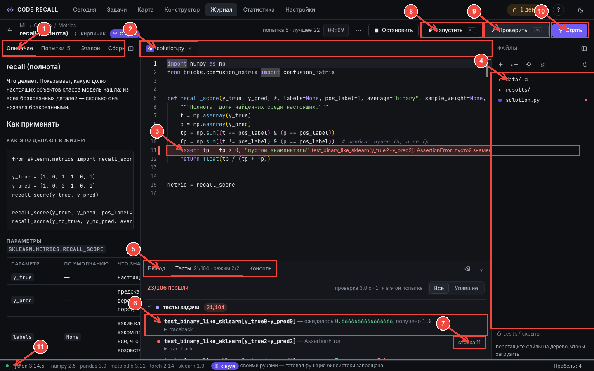
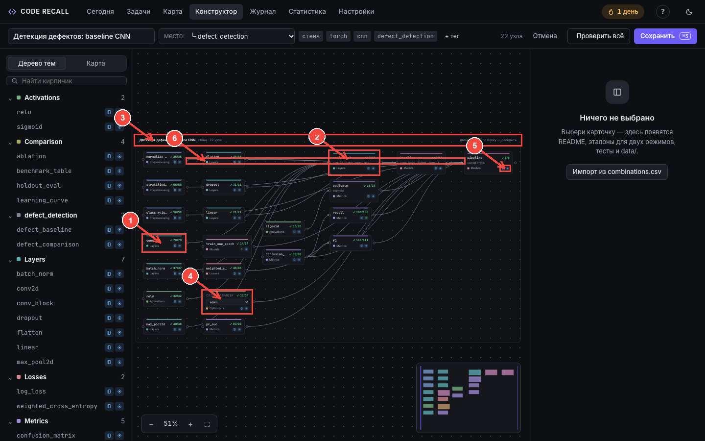

<div align="center">

# ‹› CODE RECALL

**LeetCode for the code *you* want to remember: algorithms and ML from scratch, scheduled with spaced repetition.**


English · [Русский](README.ru.md)



</div>

---

## Why

You learn an algorithm or an ML building block once, and a month later you can't write it without looking it up.
CODE RECALL turns your own reference solutions into recall exercises. You upload a task with a reference implementation and tests.
The app uses the **FSRS** spaced-repetition scheduler to decide when you should write it again from memory, in a mini-IDE, graded by **your tests**.

## Highlights

- 🧑‍💻 **Mini-IDE in the browser**: a Monaco editor with tabs, Run, an interactive Python console (variables stay alive after a run, like PyCharm's console), a file tree, and viewers for tables, images, audio and video.
- ✅ **Graded by pytest**: the tests first run against the reference, so a broken test never costs you points. Each failure shows the assertion message, the traceback, and "expected vs got".
- 🧠 **Two modes per task**: **Library** (call `sklearn.metrics.recall_score` with the right parameters) and **From scratch** (same signature, library calls forbidden). Each mode has its own repetition schedule.
- 🧱 **Bricks and slots**: tasks are built from other tasks. A CNN pipeline imports *your* `conv2d`, `relu` and `loss`. For each dependency you choose whether you write it, use the reference, or use your last passing version.
- 🗺 **Visual task builder**: a node-graph canvas (Drawflow) for assembling tasks into blocks and pipelines. It rejects dependency cycles.
- 🔍 **Semantic diff**: compares your code with the reference by meaning (`ast.parse → ast.unparse`), so whitespace, comments and quote style don't count as differences.
- 🔁 **"Fix your mistakes" loop**: 1) read the diff, 2) retype the code with the reference visible (paste is disabled), 3) write it from memory. Only step 3 affects the schedule.
- 📊 **Journal and stats**: every attempt is saved, including abandoned ones, with a score breakdown and charts of time and score over attempts.
- 📈 **No notebooks needed**: call `show(df)` or `show(fig)`, or use plain `plt.show()`, and tables and plots appear in the output panel.
- 🤖 **Optional LLM review** (Ollama locally or Groq), off by default and never part of the score.

<div align="center">

<br><sub>The task builder: a defect-detection CNN assembled from 22 bricks you have written yourself.</sub>
</div>

## Quick start

```bash
pip install -r requirements.txt   # use the environment that has your numpy / pandas / torch
python run.py                     # opens http://127.0.0.1:8000
```

| Variable | Meaning |
|---|---|
| `PORT` | port to listen on (default `8000`) |
| `NO_BROWSER=1` | don't open the browser on start |
| `DEV=1` | auto-reload |
| `CODE_RECALL_DATA` | use a different data folder (for example, a sandbox copy) |

## A task is a folder

```
quicksort/
  description.md          markdown with $LaTeX$
  task.json               metadata: kind, topic, tags, timeout, deps…
  reference/library/      reference solution using a library function
  reference/scratch/      reference solution written from scratch
  starter/                optional starting code
  tests/test_*.py         shared tests (both modes must pass)
  tests/library/          checks for Library mode (the right function is called, the right kwargs are passed)
  tests/scratch/          checks for scratch mode (forbidden names, gradients compared with torch)
  data/                   datasets, or a link to a folder on disk
```

ML tasks get the `device` (`cuda` / `mps` / `cpu`), `seed` and `data_dir` pytest fixtures automatically.

## Scoring

```
score = 100 · passed / counted tests
        − 3 for each "Check" after the 2nd (capped at 15)
        − 30 if the reference was opened before submitting
        − 10 if you took >20% longer than last time
```

The score maps to an FSRS grade (easy / good / hard / again), and the next review date is recalculated from your full history.

## Stack

**Backend:** FastAPI, SQLAlchemy 2, SQLite, pytest runner in isolated attempt folders, FSRS-4.5.
**Frontend:** plain ES modules with no build step: Monaco, marked, KaTeX, Drawflow.

The full user guide is in Russian: [`docs/ИНСТРУКЦИЯ.md`](docs/ИНСТРУКЦИЯ.md).
